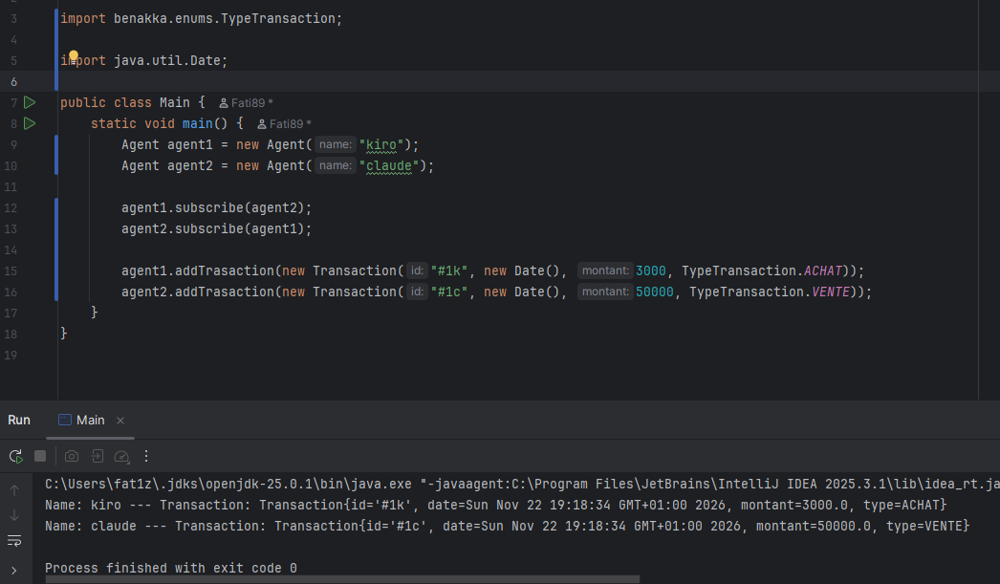

# Examen design pattern et Programmation Orientée Aspect

## Pattern Singlotton
une seule instance de Container

## Test de pattern Observer
notifier des agents d'une nouvelle transaction sans notifier lui meme
