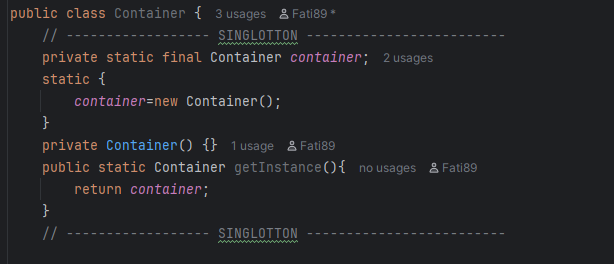
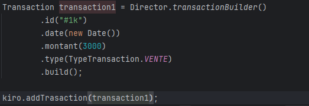
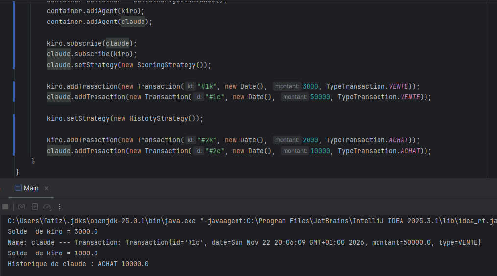
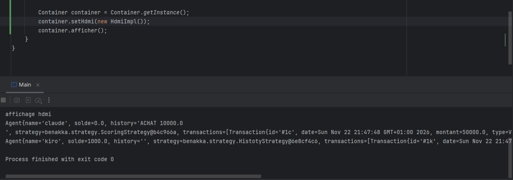
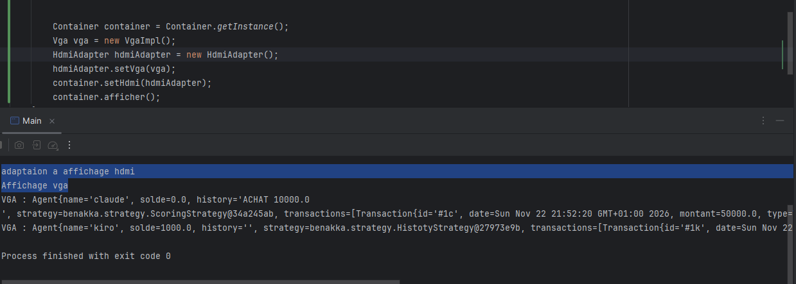
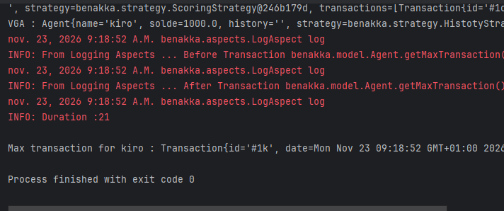

# Examen design pattern et Programmation Orientée Aspect

## Pattern Singlotton
une seule instance de Container

## Pattern Builder
### créer les transaction avec builder

## Test de pattern Observer
notifier des agents d'une nouvelle transaction sans notifier lui meme

## Test de pattern Strategy

## Test pattern Adapter
### container dans ce test utilise hdmi directement

### conterner ce test utilise vga, qui est adapté à hdmi via un vga-adapter

## AOP
### Log

### Cache

### Securité
